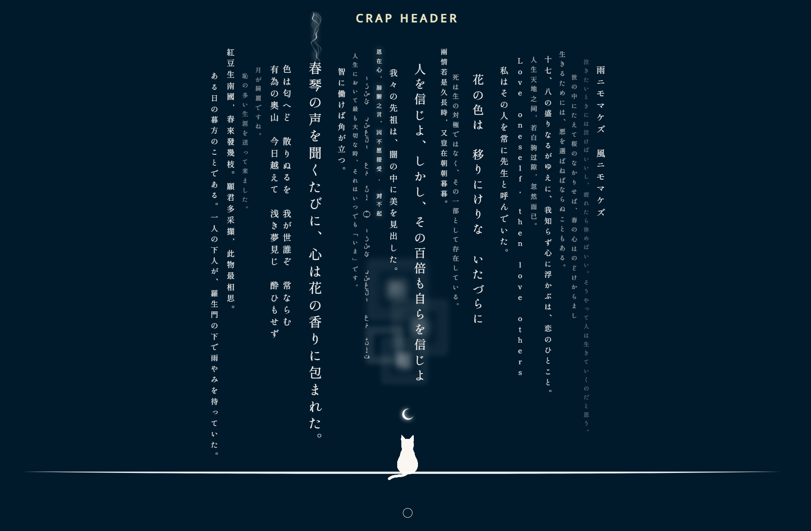

# crap-portfolio

> Don't let the name fool you. The code is anything but.

A personal UI/web-design playground built with **vanilla HTML, CSS, and JavaScript**. No frameworks, no build step. What began as a hobby project for practicing layout and animation has grown into a collection of design experiments, anchored by a fully hand-orchestrated animated hero section.

**Live site:** [hanz02.github.io/crap-portfolio](https://hanz02.github.io/crap-portfolio/)

## Highlight: The Hero Section

The centerpiece of the project. Clicking the moon button triggers a multi-stage animation sequence that resolves into a night scene: classical Japanese and Chinese literary quotes hang like vertical scrolls above a cat watching the moon.

**Desktop**



**Mobile**

.png>)

Every behavior is written from scratch in modular vanilla JavaScript (ES modules), with no animation library.

- **Orchestrated animation timeline.** A chained sequence of seven timed stages (curtain reveal, star burst, moon shrink, floor drop, message rain) built on the Web Animations API with custom cubic-bezier easing.
- **Generative layout.** On every visit the quotes are shuffled and assigned randomized font sizes, opacities, paddings, and vertical offsets, then constrained so no quote crosses the floor. Each render is unique.
- **Collision detection.** The script computes bounding-box offsets of each quote relative to the cat and moon. When a quote drifts or is hovered into that zone, the cat and floor blur to preserve visual depth (`get_middle_messages.js`, `cat_offset.js`).
- **Responsive behavior.** On narrow screens the quote field becomes horizontally scrollable with edge-aware scroll buttons, and the collision logic re-evaluates the centered quotes as you scroll.
- **Typography as design.** Vertical CJK text layout mixing Japanese, Chinese, and Arabic literary quotes, with hover states that surface each quote for reading.

## Grid Sections

### Grid V1

A responsive image grid, shown in desktop and mobile views.


.png>)

### Grid V2: "Complexity"

A denser, asymmetric grid layout.


.png>)

### V3: "Insanity" (in progress)

Layered typography and slideshow experiments, currently under active development.

## Built With

- **HTML5 / CSS3.** Mobile-first, with a custom utility-class system (`utility.css`) written before ever touching Tailwind.
- **Vanilla JavaScript (ES modules).** All animation and layout logic hand-rolled.
- **jQuery.** Used sparingly for legacy path animation (`jquery.path.js`).

## Project Structure

```
├── index.html
└── assets/
    ├── css/        # per-section stylesheets + utility classes
    ├── js/         # modular hero logic (animation, collision, scrolling)
    └── img/        # SVG/GIF assets (moon, stars, cats, floor)
```

## Roadmap

This is a living project, and new sections and refinements land as inspiration strikes. Up next: completing the V3 sections and continued polish across the site.

## About Me

Hi, I'm **Hanz**. I build expressive, detail-obsessed front-end experiences.

- GitHub: [@hanz02](https://github.com/hanz02)
- Email: [khawhanzhe@gmail.com](mailto:khawhanzhe@gmail.com)

All artwork in the grid sections is credited to its original creators via the "GO TO SOURCE" links on the site.
